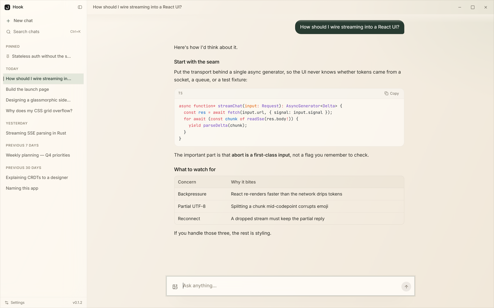
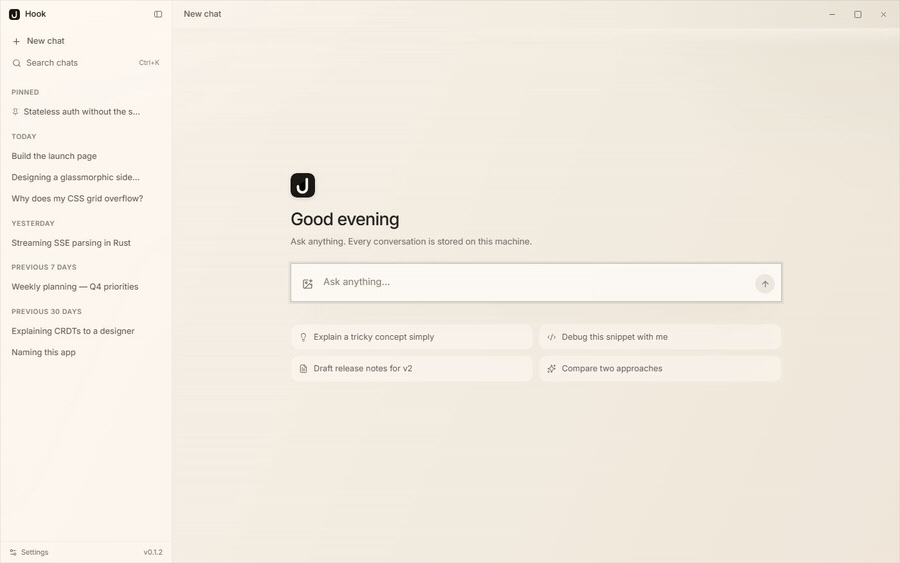
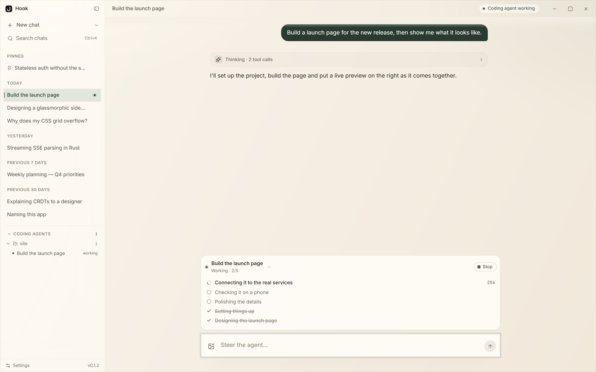
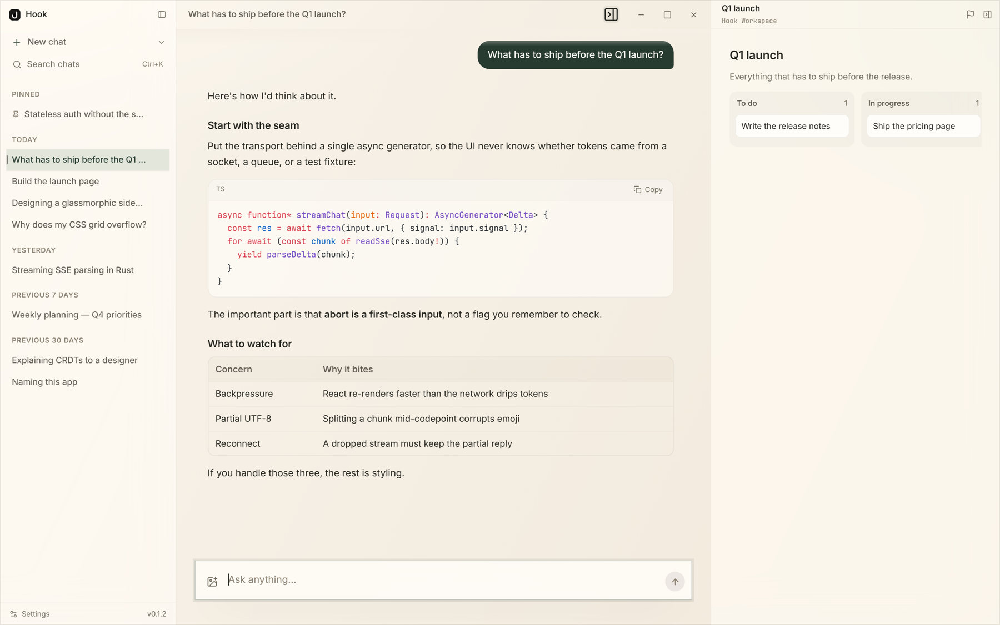
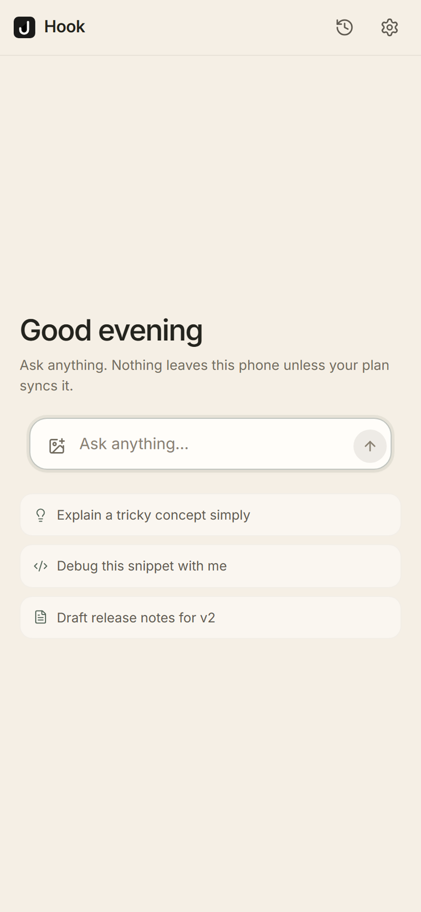
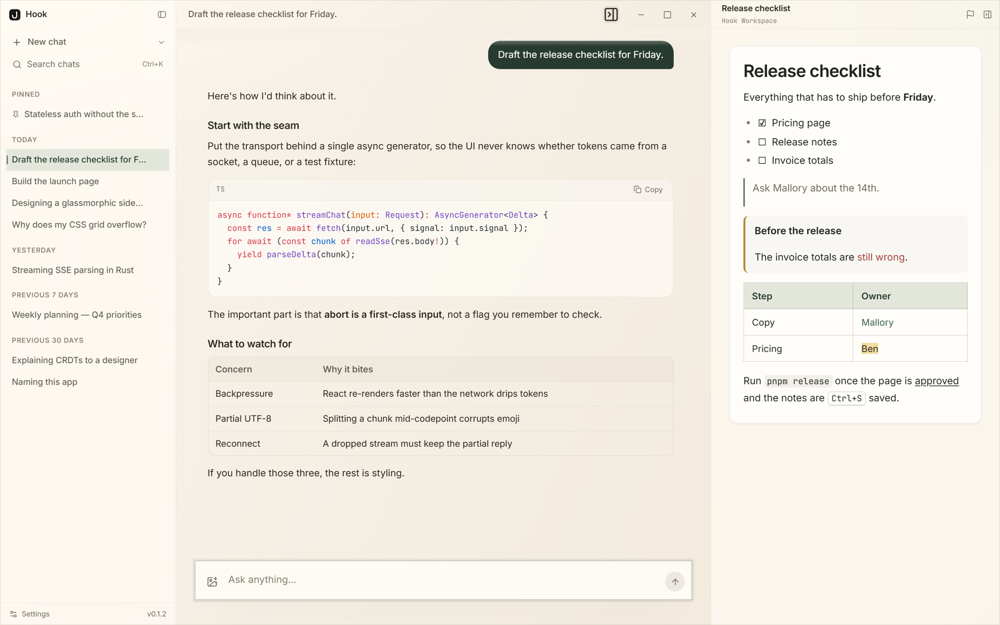

# Hook

A family of local-first desktop products around one account. **Hook** is an AI
chat app with coding agents; **Hook Workspace** — projects, boards, tasks and
documents — is the second; **HookCode** is the same account on a phone. Tauri 2
(Rust) + React 19 + TypeScript in one pnpm + Cargo workspace.




One model, one thinking level — baked in at build time. Sign in with the account
that was approved on the waiting list, and the same session unlocks the chat
window, the coding agents, and a model proxy that keeps the provider key
server-side. Chats, pictures and project code are saved to the account so the
same work continues on another computer; the provider key never leaves the
server.

> Working on the code? Start with [AGENTS.md](AGENTS.md) — commands, repo map,
> and the constraints that are not obvious from the tree.

## What it does

- **A chat that keeps the key server-side.** The desktop talks to Hook's proxy,
  never to a provider; the signed-in account's token is all the binary carries.
  Bring your own OpenAI-compatible endpoint and the app talks to it directly.
- **Coding agents in a real folder.** The chat agent briefs `pi`, which reads
  and edits a project, follows a checklist you can watch, asks when it is
  blocked, and reports back in the conversation. The panel on the right shows the
  page it is building.
- **Hook Workspace.** Boards, tasks, documents written in a Markdown dialect,
  roadmaps and roles — all on the account, so the chat agent can do the same work
  on a machine where Workspace is not installed.
- **The same conversation on a phone.** HookCode runs the same `hook-core` turn
  loop with the chat agent's hands in Workspace, and can start and steer work on
  your computers.
- **Local-first by default.** Chats and pictures are ordinary files on disk. A
  paid account may sync them, and the server is the only merger; a free account
  keeps them on the machine that made them.

## See it



Ten seconds of the real UI, driven against the mock backend (`pnpm dev`):
[`hook-demo.mp4`](docs/assets/hook-demo.mp4) (218 KB) is the same recording.

| Coding agents, advanced mode | A Workspace board beside the chat |
| --- | --- |
|  |  |

| HookCode | A document in the preview panel |
| --- | --- |
|  |  |

## Quick start

Prerequisites: Node 20+, Rust stable (MSVC toolchain), WebView2 runtime.

```bash
cp harness.config.ci.toml harness.config.toml   # required before any cargo build
pnpm install
pnpm app          # a real window, hot reload, its own data under %APPDATA%\hook-dev
```

Without an approved account, point the app at the bundled mock provider:

```bash
cp harness.config.mock.toml harness.config.toml
pnpm mock         # terminal 1 — fake OpenAI-compatible endpoint on :8787
pnpm app          # terminal 2
```

`pnpm dev` runs the chat UI in a plain browser against the same mock. The full
dev loop, the build outputs and the two traps that only appear in an installed
app are in [Getting started](docs/getting-started.md).

## Documentation

| Start here | What it answers |
| --- | --- |
| [Getting started](docs/getting-started.md) | Run it, build it, what it leaves behind |
| [Configure](docs/configure.md) | `harness.config.toml` and what each key changes |
| [Using Hook](docs/hook.md) | Settings, advanced mode, commands, keyboard |
| [Architecture](docs/architecture.md) | How it is put together |

| The rest | What it answers |
| --- | --- |
| [Coding agents](docs/coding-agents.md) · [Your machines](docs/machines.md) | A run's lifecycle, and running one on another computer |
| [Hook Workspace](docs/workspace.md) · [Hook on a phone](docs/mobile.md) | The other two products |
| [Sync](docs/sync.md) · [Plans and limits](docs/plans.md) | What travels, what merges, what is free |
| [Memory](docs/memory.md) · [Data layout](docs/data-layout.md) | What is remembered, and every file it is written to |
| [Account service](docs/server.md) · [Model proxy](docs/model-proxy.md) | The container on the VPS |
| [Releasing](docs/releasing.md) · [Microsoft Store](docs/microsoft-store.md) | How an installer ships and how it updates |
| [Tests](docs/tests.md) · [License](docs/license.md) | The suites, and the terms |

Everything, including the reference documents, is indexed in
[`docs/`](docs/README.md).

## How it is put together

One Rust crate (`crates/hook-core`) is the backend every product links: the
assistant turn, tools, memory, the coding-engine supervisor, chats on disk, the
sync engine, auth and the IPC surface. A product passes `Product` and
`Capabilities` to `hook_core::builder`, and the chat agent's prompt and toolset
are trimmed to what that product can honour — the shared packages
(`packages/ui`, `packages/chat`, `packages/markdown`) are the other half of "the
same family", enforced by the build rather than by discipline.

[Architecture](docs/architecture.md) has the crate map and the details.

## License

Hook is **AGPL-3.0-only** — use it, modify it and self-host it, personally or
commercially. Running a modified version as a network service means publishing
your changes. A fork must also rebrand: the names and the mark sit outside the
code license, as do the bundled programs (MinGit, Node, `pi`). See
[License](docs/license.md), [LICENSE](LICENSE), [NOTICE](NOTICE),
[TRADEMARK.md](TRADEMARK.md) and [THIRD_PARTY_NOTICES.md](THIRD_PARTY_NOTICES.md).

A signed [CLA](CLA.md) is needed before a non-trivial pull request can be
merged, because dual licensing requires the project to hold sufficient rights
over every contribution — you keep the copyright to your own work. See
[CONTRIBUTING.md](CONTRIBUTING.md). Commercial licensing: **support@hookcode.io**.
