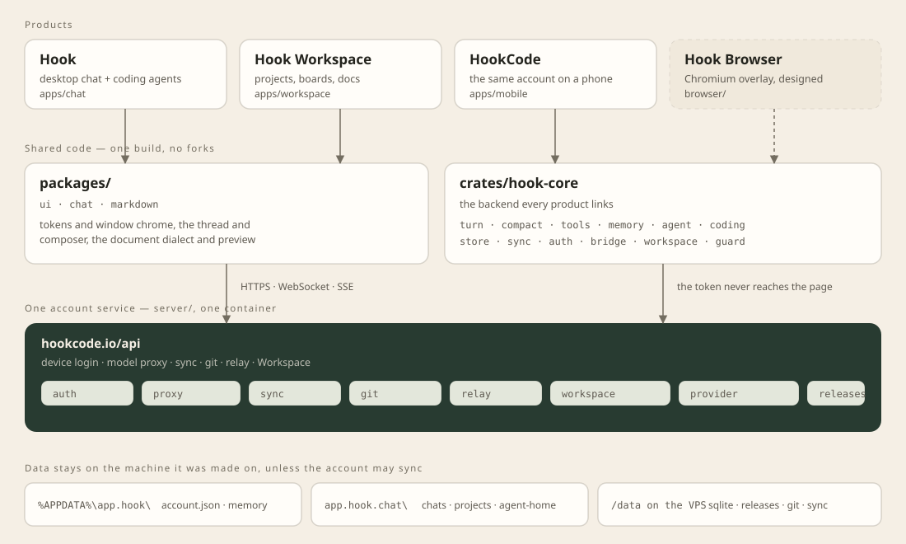

# How it is put together

The crate map, the two kinds of conversation, streaming, cancellation, persistence and the window chrome.



```
crates/hook-core/src/          the backend every product links
  config.rs     include_str! the TOML, expose typed config
  provider.rs   OpenAI-compatible SSE client + streamed tool_calls
  store.rs      atomic JSON persistence, pin/delete/restore/search
  turn.rs       the assistant turn: model → tools → tools → answer, plus wakes
  compact.rs    folding a long conversation into a summary
  slash.rs      the composer's commands (a registry, the parser, the runner)
  tools.rs      the tool schemas and their implementations
  agent.rs      engine RPC supervisor: spawn, states, plans, progress batching,
                wakes, stop-chat, read-only session transcripts
  coding.rs     a chat the user has with one coding agent directly: pi records →
                chat messages, steer/stop/answer, local-only sessions
  bridge.rs     loopback endpoint that runs the chat agent's own tools for a
                directly-driven agent (token per chat, advertised names only)
  runtime.rs    locate the bundled engine, write its models.json
  guard.rs      the guard extension, materialized from the binary
  update.rs     release index, update policy, checksum-checked installer
  settings.rs   projects folder, memory switch, advanced-mode fallback, the
                personal endpoint and its change stamp
  projects.rs   folder scanning, stable account ids, descriptions, containment
  git.rs        bundled git, managed config, repository preparation
  sync.rs       background chat/picture/project/memory/endpoint sync, server-side
                merge cursor
  auth.rs       device flow and the account file shared by every product
  commands.rs   the IPC surface
  lib.rs        Product + Capabilities, the app builder every product calls
apps/chat/                     the chat product
  src/lib/bridge.ts  typed invoke wrappers + app-wide event bus
  src/store/         zustand: chats, per-chat streams, agents, settings
  src/components/    Sidebar, Thread, Composer, AgentBoard, AgentTree,
                     AgentInspector, SettingsSheet…
  src/styles/        this product's layout (the foundation lives in packages/ui)
apps/workspace/                Hook Workspace
apps/mobile/                   HookCode on a phone (no agents, no folder)
  src/components/    ChatList, Conversation, PreviewSheet, SettingsSheet
  src/mobile.css     the phone's re-skin of the shared thread and composer
packages/ui/                   tokens.css, window chrome, primitives, the mark
packages/chat/                 Thread, Composer, ChatDock, Markdown…
  src/preview/       a board, a task and a document, drawn from preview JSON
```

The account service holds two more modules that every desktop product talks
to:
`server/git.mjs` (smart HTTP over `git http-backend`, one bare repo per project,
the `git-policy.mjs` size hook) and `server/sync.mjs` (cursor, chat merge,
project metadata, content-addressed media). Both are mounted under `/api`; git
is mounted before any JSON parser because pushes are binary streams.
`server/provider.mjs` is the third: the account's personal model endpoint, kept
apart from `/sync` because its key needs its own rule (AES-256-GCM at rest,
metadata and secret on separate routes).

Details worth knowing:

- **The renderer never sees the key.** All network calls happen in Rust.
- **Two kinds of conversation.** A chat is either a model turn (`turn.rs`) or the
  engine itself (`coding.rs`); `ChatMeta.kind` says which. Both write the same
  `Message` list, which is why the thread, the work blocks, the task board and
  the preview do not care — and why `packages/chat` never learns that `pi`
  exists. A `coding` chat is local-only and hidden while Advanced is off.
- **Streaming** arrives on one app-wide `hook://chat` event (user turns and
  agent-woken turns alike); deltas are coalesced per animation frame in the store
  so React re-renders at most ~60×/s, and several chats can stream at once.
- **Cancellation** is cooperative (`CancelToken` → `tokio::select!`), so a
  stopped reply is still persisted with its partial text and `aborted` status.
- **Persistence** is atomic (write temp file, then rename), so a crash can't
  leave a half-written chat.
- **Window chrome** is frameless with a custom titlebar and native rounded
  corners. The glass surfaces (sidebar, composer) are pure CSS — no dependency
  on OS backdrop materials, so it looks the same on every machine.

---

[Documentation](README.md) · [Hook](../README.md)
