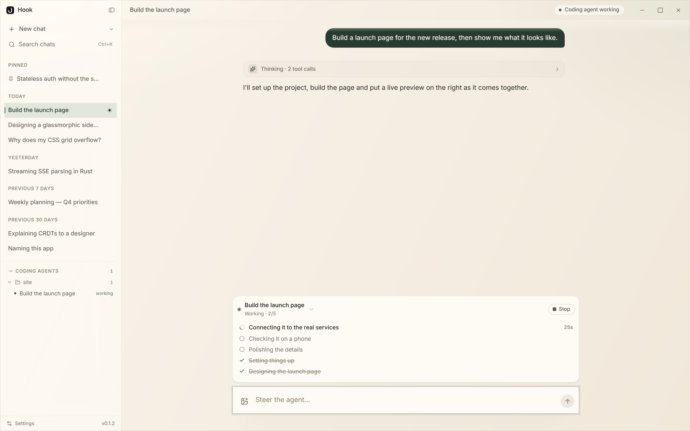

# Coding agents

The chat agent starts a `pi` subprocess, follows it and reports back — plus the conversation you can have with the engine yourself.



The chat agent can create projects, brief a coding agent, and report back in the
conversation while you keep chatting.

A coding agent needs a paid plan, or a model endpoint of your own (see **Plans,
limits and your own model**). A free account without one gets a refusal from the
backend, no agent tools in the chat agent's toolset, and `coding_not_included`
from the proxy if a stale client tries anyway. With a personal endpoint the
engine is pointed at that endpoint and model instead of Hook's proxy.

- **Projects** live in one folder (default `~/Documents/Hook`), configured in the
  Settings sheet. Every chat can use every project. Each project carries a short
  description the chat agent maintains — that description is how it finds the
  right project later.
- **Instructions travel with the code.** `remember_in_project` writes a line
  into the project's `AGENTS.md` (in a marked block, see [Memory](memory.md)),
  and `pi` reads that file every run. "Use pnpm, not npm" said once is then true for every
  coding agent in that repository, on every computer.
- **Projects are shared across computers** (on a paid account with sync on).
  Each project has an account id; the local folder name and path are per-machine. A project created here is a
  git repository with Hook's service as its `hook` remote, and an existing
  project gets one initial snapshot the first time it joins the account. On a
  second computer the folder is created and pulled automatically. Coding agents
  are told to call `sync_pull` before they start (the folder may be empty because
  the work began elsewhere) and `sync_push` when they finish, are blocked or
  stop early. The guard blocks force-pushes, branch deletion and mirroring, so a
  shared project cannot lose another computer's history.
- **Git ships with Hook.** `scripts/fetch-git.mjs` installs a pinned MinGit into
  `src-tauri/resources/git` (per app, next to the engine) like the coding engine (its GPL `LICENSE.txt` ships
  with it). Agents get it on `PATH` and a managed `gitconfig` in `agent-home`;
  the account's git token is scoped to `/api/git/*` and cannot read chats or
  spend model credits. The token lives in that config, never in a project or a
  remote URL.
- **The chat agent never touches files.** Its tools are `list_projects`,
  `create_project`, `update_project_description`, `start_coding_agent`,
  `list_agents`, `agent_status`, `steer_agent`, `answer_agent`, `stop_agent`
  and `list_coding_sessions`. All code reading and editing happens inside a
  coding agent, including setting the preview panel.
- **Hook ships its own engine.** The installer carries a Node runtime and the
  pi coding agent's bundle as app resources; agents run on that copy. Nothing is
  installed on the machine, nothing is looked up on `PATH`, and there is no
  setting for it anywhere in the UI.
- **Coding agents are pi subprocesses**, driven over `--mode rpc` with the
  project folder as their working directory:

  ```
  <resources>/node.exe <resources>/pi/dist/bundle/cli.js --mode rpc
     --session-dir <appdata>/agent-sessions --session-id <id> --name "<title>"
     -ne -e hook-guard.mjs -ns -np --no-mcp -na --model hook/<model>
  ```

  `PI_CODING_AGENT_DIR` points at `%APPDATA%\app.hook.chat\agent-home`, whose
  `models.json` is written atomically from `harness.config.toml` before launch.
  The model credential is referenced as `$HOOK_PROVIDER_TOKEN` and supplied
  through the agent's environment — the account token for Hook's proxy, the
  user's own key for a personal endpoint. `$HOOK_API_TOKEN` stays the account
  token because the guard's web search needs it. The run id and chat id travel as
  `$HOOK_AGENT_ID` / `$HOOK_CHAT_ID` headers, so concurrent agents report usage
  against the right conversation; a personal endpoint gets none of them. An agent uses exactly the chat agent's endpoint and model and
  never touches your own `~/.pi` — different extensions, skills, MCP servers and
  logins on your machine cannot change what it does. Its thinking level is its
  own: with `[coding] thinking` empty the engine uses its default (medium)
  rather than the chat model's level, because a run is dozens of small turns and
  a high level on each one leaves the checklist frozen for minutes at a time.
- **The plan is visible, and so is the Stop button.** `start_coding_agent` takes
  a `plan`: three to six short steps in plain language (`Setting things up`,
  `Designing the front page`, `Hooking up the real service`), written by the
  chat agent, never file names or jargon. That checklist sits directly above
  the composer with the run's title: the active step shows a spinner, finished
  steps are struck through and settle to the bottom of the list, and only the
  step in progress carries a clock: it ticks while the agent works on it, and
  the time disappears once the step is crossed off. The coding agent
  keeps it current through `update_plan`, and a clean finish crosses off
  whatever is left. It cannot quietly batch the steps to the end: after a few
  tool calls without a checklist update a reminder rides on the tool result,
  and after more the next tool call is refused until the plan moves — so a
  long run's step actually changes while the work does. While an agent is
  live, the composer says **Steer the agent…**: your message is still answered
  by the chat agent, which passes the instruction on with `steer_agent`
  instead of starting a second agent. **Stop**
  kills every live agent in that chat — abort first, then the process tree —
  without a model round-trip. A finished checklist stays for a few minutes, then
  gets out of the way.
- **Progress updates — only when there is news.** Agents get one extra tool,
  `report_progress(note, images?)` and are told to use it for milestones,
  decisions, problems and the final result, never as a heartbeat: "still
  working" is explicitly off-limits, and long silences are expected. Notes go
  into a mailbox Hook watches; Hook batches them (at most one batch a minute,
  immediately on finish/fail/question) and hands the chat agent a note. The chat
  agent may answer `no_update`, which drops the message entirely — a batch that
  says nothing worth reading produces nothing in the chat. A quiet job can go
  from start to finish with a single update, or none until the result.
  A settle that follows an update the chat agent already spoke about is not
  news either: that wake carries only `new_since_last_update: none` and no
  copy of the run's final report, so the chat agent cannot repeat itself. A
  settle from a run nobody ever heard about is always reported. Pictures
  travel with the message the chat agent writes, so an update reads like "here
  is the menu as it stands" with the screenshot right there. How an agent
  produces them is up to it: a headless browser, the project's own harness, an
  engine's screenshot API.
- **A live preview when there is something to see.** The coding agent gets a
  `show_preview(file, title)` tool: it puts one HTML page from its project in a
  panel on the right. Hook serves the project over a loopback HTTP server, so
  relative CSS, images, modules and `fetch` behave like a normal browser, and
  the frame reloads whenever a web asset in the project changes. The page does
  not have to exist yet: the panel waits and loads it the moment the agent
  writes it. A small “Live preview” badge explains that the page is still in
  progress: it can change or reload on its own while the agent works. Previewing
  is optional and for the user's eyes — a frontend task, a data analysis with
  charts, a visual report. The guard tells the agent to set it early, and the
  chat agent asks for it in the brief. The first time a run shows a preview the
  panel opens; the user can hide it and bring it back from the title bar.
  Calling `show_preview` again switches the page. Hook watches only that one
  project. When the coding-agent run settles, the panel stays open and the page
  stays available: only the automatic refreshing stops, and the badge goes
  away, so the user can reload by hand. A deleted chat or quitting Hook stops it
  and closes the panel.
- **Context and output budget.** `[coding] context_window` (1,048,576) and
  `max_output_tokens` (393,216) are what `models.json` advertises to pi; both
  should match the model (check `GET /models`: `context_window` and
  `max_output_tokens`). The provider rejects a larger `max_tokens` outright, so
  this is the one ceiling to keep honest. pi clamps the output number to
  whatever room is left in the window (`window - prompt - 4096`). Lower it to
  cap cost: a tight cap is what makes a thinking model burn the budget on
  reasoning and stop with nothing written. The chat agent's own
  `[model] max_tokens` is separate.
- **Pictures from you.** Paste, drag or pick an image in the composer. Bytes are
  downscaled and stored on disk, not in the chat JSON.
- **Vision is a capability, not a setting.** At startup Hook asks the provider
  what the model does (`GET /models`, right next to the chat endpoint) and reads
  `input_modalities`, OpenRouter's `architecture`, or a `vision` flag. If the
  card says images, pictures reach the model as image parts and the engine is
  told the same before any agent starts; if it does not, or the provider has no
  model list, your pictures stay visible to you and are described in text. A
  card that promises more than the endpoint delivers costs that turn one retry
  without pictures, and Hook stops trying.
- **Image budget.** `[provider] max_images` (3) caps how many pictures reach the
  model in one request. The newest ones win: a fourth screenshot pushes out the
  oldest, which stays visible in the chat but is sent as
  `[older image omitted: 1280x800 png]` instead of pixels. A message can carry
  several pictures, so the budget is applied per attachment, not per message.
- **Looking at a picture.** Click any attachment — yours or an agent's
  screenshot — to open it large. From there: **Open** hands the file to your own
  image viewer (staged in `%TEMP%\hook-images`), **Save as…** writes a copy
  wherever you choose through the native dialog, **Full screen** (or a double
  click) fills the window. Esc closes, ← → step through the pictures in a
  message. Full-page captures scroll at readable width instead of shrinking to a
  sliver.
- **The guard is the only policy they inherit.** Every `bash` call must carry a
  `timeout` in seconds (1–3600 by default). Missing, oversized or non-numeric
  timeouts are blocked with an explanation, and the model re-issues the call.
  Tune it with `bash_max_timeout` / `bash_min_timeout`. The same guard offers
  `report_progress`, `update_plan`, `show_preview` and `web_search`, and seeds the coding
  agent with the checklist the user is watching so the wording stays plain. The
  checklist is also enforced: every third tool call without an `update_plan`
  carries a one-line reminder, and after five the next call is blocked with the
  current checklist. Both counters reset, so a run that keeps ignoring it can never hang.
- **They run asynchronously.** `start_coding_agent` returns immediately and you
  can keep talking. When an agent settles, fails, or asks a question, Hook
  appends a hidden note to the owning chat and wakes the chat agent, which posts
  an update in its own words. If the chat agent is mid-turn, the wake waits.
- **You see the work, not the machinery.** A title-bar pill says an agent is
  working (or waiting for an answer), the chat's task board shows the plan and
  how long the current step has been running, and every chat with a live agent
  gets a green dot in the sidebar.
  There is no log, no tool feed and no session browser: the raw run stays
  between Hook and the chat agent, and everything you read in the conversation
  is written by the chat agent.
- **Sessions are resumable.** They live in
  `%APPDATA%\app.hook.chat\agent-sessions\`. A finished agent — or one that
  was cut off when Hook closed — can be continued by session id.

Agents are children of Hook: closing the window kills their process trees and
marks the run `interrupted`, so nothing keeps running behind your back.

## Talking to a coding agent directly

The chat agent is not the only way to start a coding agent. With **Advanced**
on — and on a paid plan, or with your own model endpoint — the sidebar's **New
chat** button has a menu with **Coding agent…**: it asks for a folder and opens a
conversation with `pi` in it. There is no chat agent in
that conversation — what the engine says is what you read.

- **It is a chat, not a task-board entry.** The conversation sits in the normal
  list, marked with a terminal, and draws its thinking, tool calls, status line,
  plan and preview with the same components a chat turn uses. It does *not*
  appear in the **Coding agents** tree, which stays a list of runs the chat
  agent started. Nothing seeds a plan here, so the task board stays out of the
  way until the agent writes its own checklist with `update_plan`; from then on
  it is the same board — steps, clock and the finished list for a few minutes.
- **Any folder.** The picker accepts any folder on disk. One inside the projects
  folder keeps its account repository and the `sync_pull` / `sync_push` tools;
  any other folder is used as it is, and the guard is told not to advertise git
  tools that have no repository. `ChatMeta.projectPath` holds the path, and
  **Change folder…** in the chat's menu points it somewhere else (which starts a
  fresh engine session, since the old session belonged to the old folder).
- **The chat agent's own tools come along.** On top of its file, shell,
  `web_search`, `update_plan` and `show_preview` tools, a direct agent gets what
  the chat agent can do with Hook's data: `list_projects`, `create_project`,
  `update_project_description`, `remember_in_project`, `remember` /
  `memory_search` / `forget` and the `workspace_*` family. The pinned memory the
  chat agent gets is in its prompt too. Two things are left out on purpose:
  `report_progress` (nobody relays it — the answer itself is the update) and
  every tool that starts, inspects or steers another coding agent (there are no
  subagents in this direction).
- **How those tools reach it.** The guard cannot call Rust, so `bridge.rs`
  listens on loopback and the guard `fetch`es it with a token minted for that
  chat. The schemas are written into the agent's mailbox (`tools.json`) from the
  same `definitions()` the chat agent uses, so the two surfaces cannot drift, and
  the endpoint only runs the tools that were advertised for that token.
- **You steer it yourself.** While it works, Send hands your message to the
  running agent and Stop kills it; a question it is blocked on appears in the
  task board with its options. A settled run stays warm for five minutes, and a
  later message resumes the same session (`ChatMeta.sessionId`), even after a
  restart. `/compact` asks the engine to fold its older turns into a summary
  (pi's own `compact` RPC); the chat's messages stay on screen, and the fold is
  drawn in advanced mode like any other.
- **Local only.** A coding-agent chat is never uploaded: the folder, the engine
  process and the session file exist on one computer, and half of that arriving
  on another would be worse than not arriving at all. Turning **Advanced** off
  hides these conversations from the sidebar and closes one that is open back to
  the empty pane (nothing is deleted; the chat returns with the switch, because
  the simple view cannot draw a run's tool-by-tool turns). Hook Workspace's dock
  never lists them.

---

[Documentation](README.md) · [Hook](../README.md)
