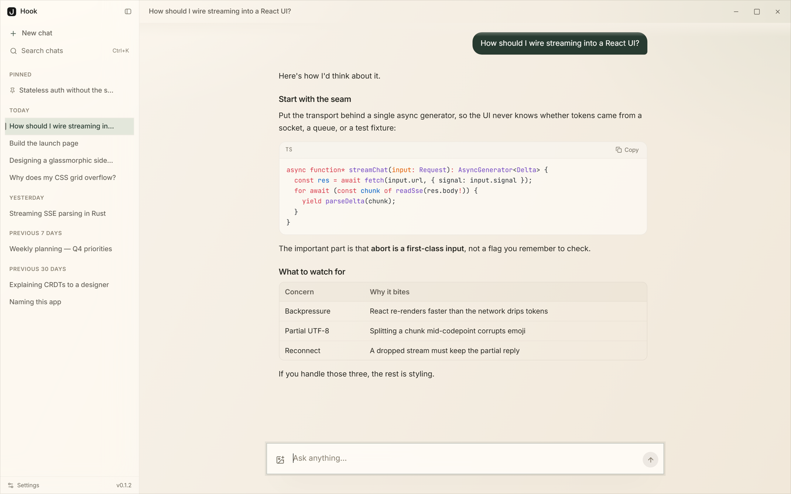

# Getting started

Prerequisites, the dev loop, a build, the outputs it leaves, and the two traps that only appear in an installed app.



## Run

Prerequisites: Node 20+, Rust stable (MSVC toolchain), WebView2 runtime.

```bash
cp harness.config.ci.toml harness.config.toml   # production proxy config
pnpm install
pnpm app          # dev window with hot reload
```

`harness.config.toml` is gitignored so you can keep a local provider. On a fresh
clone, copy `harness.config.ci.toml` (the config a release is built with) or
`harness.config.example.toml`. The production config requires a signed-in
approved account. For UI work without the service, use the mock provider below.
The config file must exist before building — it is compiled into the binary, so a
missing file is a compile error by design.

`pnpm app` is a debug build, so it keeps its own data under
`%APPDATA%\hook-dev\` and is signed out the first time it starts. See
[Where the data lives](data-layout.md).

No API key yet? Use the bundled mock provider:

```bash
cp harness.config.mock.toml harness.config.toml
pnpm mock         # terminal 1 — fake OpenAI-compatible endpoint on :8787
pnpm app          # terminal 2
```

Restore the production config afterwards (`cp harness.config.ci.toml harness.config.toml`).

## Build

```bash
pnpm engine        # fetch the coding engine into apps/chat/src-tauri/resources/pi-runtime
pnpm git           # fetch the bundled git for coding agents
pnpm app:build     # the chat app's NSIS installer (runs `pnpm engine` and `pnpm git` first)
pnpm app:portable  # portable folder for the chat app, zipped

pnpm workspace:app         # Hook Workspace dev window
pnpm workspace:app:build   # Hook Workspace NSIS installer (its own engine copy)
```

Both apps share one Cargo workspace, so `cargo build` output lands in `target/`
at the repo root; the Tauri CLI still runs per app (`apps/chat`, `apps/workspace`).

Outputs for the chat app:

- `target/release/bundle/nsis/Hook_<version>_x64-setup.exe` — installer,
  ~78 MB (`pnpm release` copies it to `release/Hook-<version>-setup.exe`)
- `release/Hook-<version>-portable.zip` — `Hook.exe` + `resources\pi-runtime` +
  `resources\git`, no install

`compression: "bzip2"` is a deliberate trade. Measured on this payload (195 MB of
MinGit + Node + pi): LZMA produced 46.6 MB in 92 s, bzip2 69.9 MB in 17 s. The
installer is therefore ~24 MB larger and every build is ~75 s shorter; building
is the scarcer resource. Switch that one line back to `"lzma"` if download size
ever matters more. `bundle.useLocalToolsDir` keeps the NSIS tools in
`target/.tauri`, so they are cached with the build directory instead of
downloaded on every runner.

The same commands with `workspace:` in front produce Hook Workspace's installer
(`target/release/bundle/nsis/Hook Workspace_<version>_x64-setup.exe`, published as
`release/Hook-Workspace-<version>-setup.exe`) and
`release/Hook-Workspace-<version>-portable.zip`. Two products, two installers,
two source hashes, one `target/` directory.

The engine (Node + pi) is ~104 MB of binaries and is not in git; `pnpm engine`
copies it from the pinned `@earendil-works/pi-coding-agent` dev dependency.
`scripts/fetch-git.mjs` adds the pinned MinGit tree (~93 MB extracted) for the
coding agents' project sync. `scripts/fetch-pi-runtime.mjs` also proves the copy
can load Hook's guard before anything gets packaged.

`pnpm version:bump patch|minor|major` is the only way to change a version (see
[Updates](releasing.md#updates)); add `--product workspace` for the second product.
Hand-editing one of the three files makes the app and the installer disagree.

`harness.config.toml` is gitignored so a local developer can keep a custom
provider. `pnpm release` swaps in the committed `harness.config.ci.toml`
(hookcode.io proxy, no secrets) for the build and restores yours afterwards.

## A note on packaged builds

Two things only break in an installed app, never in `tauri dev`:

- Tauri hands out resource paths with the Windows `\?\` prefix. Node cannot load
  a script through one, so `runtime.rs` strips it before spawning (`strip_verbatim`).
- Resources are mapped with a directory rule (`"resources/pi-runtime": "pi-runtime"`).
  A `**/*` glob flattens the tree and the engine loses `pi/dist/bundle/cli.js`.

Both are covered by tests, and the portable zip is verified with
`src-tauri/resources/pi-runtime` moved aside so the dev copy cannot mask a
packaging bug. Agents write their stderr to `%APPDATA%\app.hook.chat\logs\`
(`%APPDATA%\hook-dev\app.hook.chat\logs\` for a debug build).

---

[Documentation](README.md) · [Hook](../README.md)
