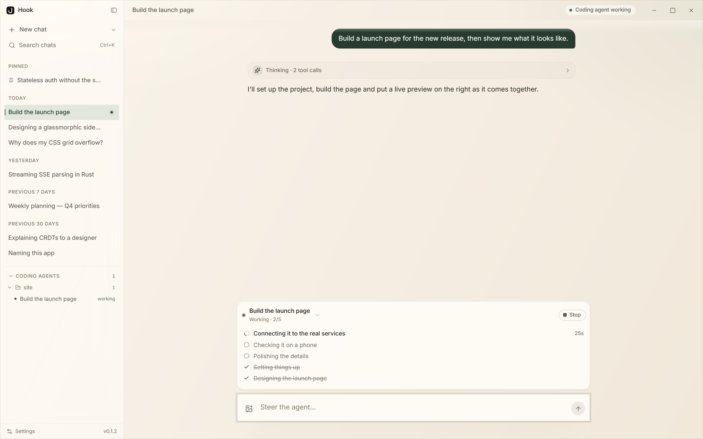

# Using Hook

The settings sheet, advanced mode (thinking, tool calls, commands, compaction), and the keyboard.

## The settings sheet

The Settings sheet (gear in the sidebar footer) holds the account, Import
history, **Advanced** mode, Memory, Sync, the projects folder and updates.
Provider and model settings — and everything about the coding engine — stay
compiled into the build.

## Advanced mode

Settings → **Advanced** turns on a debugging view of how answers are made. It is
off by default and belongs to the **account**, not to a machine or a product: a
phone should show what the computer shows, not its own idea of the view. The app
reads it from `/api/auth/me` and writes it through `POST /api/auth/preferences`
(`advancedMode`); a local `settings.json` value is what a signed-out or
local-preview build falls back to, and it is seeded to the account the first time
a window that already had the switch on signs in. It is a boolean, not content,
so a free account may set it — the paid-plan rule guards the cloud-sync switch,
not the display preference.

- **In a conversation**, a turn keeps the order it happened in: each message the
  model wrote, with one fold of thinking and tool calls between the messages.
  The newest fold stays open while the turn runs; when the turn ends it closes
  to one line (`Thinking · 2 tool calls`) and that line reopens it. Tool calls
  get a readable title and the argument that identifies the work (the command,
  the path, the query); expanding one shows the full arguments and the result.
  Nothing new is written for this: reasoning and tool calls were already in the
  chat file, and the history/prefix rules in
  [Memory → Why the prefix is append-only](memory.md#why-the-prefix-is-append-only)
  are unchanged.
- **With Advanced off**, the conversation is the simple view: only the last
  message of each turn is drawn. Everything before it — earlier messages,
  thinking, tool calls — is hidden and belongs to Advanced. The prompt always
  says that the final message must contain the complete answer, so the same
  reply works in both views. The Workspace dock always has this view; the chat
  window and the phone can turn Advanced on. A direct coding chat keeps every
  message in the simple view, because its engine is not given that rule.
- **Automatic compaction is drawn as what it is.** A long conversation is
  summarized rather than replayed forever (see [Configure](configure.md),
  `[compact]`); the summary is a hidden message, so the simple view shows only
  the thinking line
  while it is written. With Advanced on, the cut is drawn where it happened: one
  line — *37 messages folded into a summary · 312k → 9k tokens* — that expands to
  the summary itself, at the point in the conversation it covers. A direct coding
  chat gets the same line from pi's own compaction (`/compact`, or the engine's
  automatic one), with the transcript itself untouched.
- **Commands.** With Advanced on, typing `/` in the composer opens a menu of
  commands; the same registry (`crates/hook-core/src/slash.rs`) decides what the
  backend accepts, so a hidden command cannot be typed in. The catalogue is
  returned by `slash_commands` and is empty unless Advanced is on. Today:
  `/compact [what to keep]` — compact now instead of waiting for the share — in
  both an ordinary conversation and a direct coding-agent chat. Adding a command
  is one entry in `COMMANDS` and one match arm in `slash::run`.
- **The sidebar** gains a **Coding agents** tree: one folder per project, with
  rows for runs that are still working, plus a run that stopped (stopped,
  failed, interrupted) in the open chat within the last few minutes. Older
  stopped runs and successful ones stay out of the tree; the one you are
  inspecting stays even if it finishes, until you switch chats. Clicking a row
  opens a read-only inspector with the same rendering — the brief, the agent's
  thinking, its narration, every tool call and result — and keeps polling while
  the run is live (`agent_transcript` reads the pi session file in
  `agent-sessions/` plus an in-memory tail for the message being streamed).
  There are deliberately no steering controls: steering, answering and stopping
  a run the chat agent started stay a conversation with the chat agent.
- **New chat gains a second way to start.** With Advanced on, the button has a
  menu with **Coding agent…**, which opens a conversation with the engine itself
  (see [Talking to a coding agent directly](coding-agents.md#talking-to-a-coding-agent-directly)). Turning Advanced off hides those
  conversations from the sidebar and closes one that is open; nothing is deleted,
  and they come back with the switch. On the phone the same rule hides the
  **Code on <machine>** chip on the home screen and the coding-agent rows in the
  archive. With Advanced off the chat agent is still the way to get work done on
  a machine: it has the same tools and starts the run from an ordinary
  conversation.

## Keyboard

| Shortcut | Action |
| --- | --- |
| `Ctrl/⌘ + N` | New chat |
| `Ctrl/⌘ + K` | Search chats |
| `Ctrl/⌘ + B` | Toggle sidebar |
| `Ctrl/⌘ + V` | Paste an image into the composer |
| `Enter` | Send |
| `Shift + Enter` | New line |
| `Esc` | Stop generating |
| Double-click a title | Rename |

---

[Documentation](README.md) · [Hook](../README.md)
