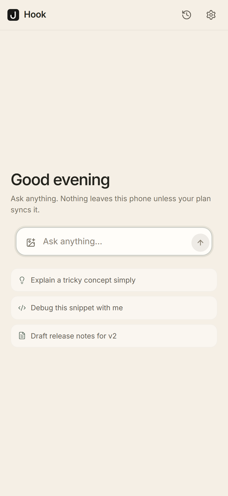

# Hook on a phone

Hook: the same backend, the same chat surface and the same account, with nothing that needs a folder on a disk.

 

Hook on a phone (`apps/mobile`, identifier `app.hook.mobile`) is the third
product and the first one that is not a desktop installer. It is the same
conversation and the same account, with the chat agent's hands in Hook
Workspace — and nothing that needs a folder on a disk.

It is the same code, not a second implementation:

- **The backend is `hook-core` with `Capabilities::mobile()`.** Workspace tools,
  memory, `web_search` and `search_past_chats` are on. `coding_agents`,
  `projects` and `preview_pages` are off, and the prompt sections that describe
  them — `## Projects` and `## Preview panel` — are removed before the model sees
  them, so the agent is never told to open a folder it cannot reach. The
  `## Coding agents` section stays, with one added line: this device is a
  controller, so it starts and steers work on a computer but never runs an agent
  itself.
- **The turn runs on the device.** The same `turn.rs` loop, the same tools, the
  same `/api/v1` endpoint. Nothing server-side was added to make this work, and
  there is no second system prompt to keep in step. The trade is that iOS
  suspends the app: a reply that is still streaming when the screen locks is
  persisted as it stands and finishes as an error you can retry, rather than
  completing in the background.
- **The chat surface is `packages/chat`.** `mobile.css` is the phone's re-skin of
  the same thread and composer, the way `dock.css` is the 380px re-skin. The
  composer's **+** opens the phone's own attachment menu (photo library, camera,
  a file picker that is not wired yet), and the shared `Composer` only needed an
  `onAttach` hook for it: the pickers themselves are the WebView's own
  `<input type="file">`, so no plugin and no new dependency.
- **The home screen is a new conversation, under one header.** The header is the
  drawer button, a centred Hook mark and New chat, on the welcome screen, a
  thread and Workspace alike. History lives in `ChatDrawer` — a left drawer
  opened by the button or a right-swipe from the edge, closed by a left-swipe, the
  scrim or a chosen row — with search, Today / Yesterday / Previous 7 Days /
  Older, and the account at the bottom. Sending starts the chat and the same
  screen becomes its thread, so a new chat is never a separate destination.
  The welcome screen's rows only stage their prompt in the composer; they do not
  send, because a suggestion is a starting point a person edits. Its greeting is
  the shared catalog (`packages/chat/src/greeting.ts`), drawn once per session
  and rotated per time window like the desktop's.
- **Workspace on the phone is its task list.** There is no phone Workspace app,
  so `WorkspaceTasks` reads the account's projects, boards and tasks through the
  same `ws_request` command the Workspace window uses and draws a plain list; a
  row opens the shared `TaskPreview` sheet. It is read-only, invents no data and
  needs no new endpoint. **Show my tasks** and the drawer's Workspace row both
  open it.
- **Coding agents are an Advanced action, here as on the desktop.** The **Code on
  <machine>** chip on the home screen, the drawer's coding-agent rows and the
  conversation that would show one all follow the account's advanced mode. With
  it off the chat agent is the way in: it has the agent tools and the machine
  list, so it decides whether a machine is needed and starts the run itself. A
  phone does not offer a second, simpler path into the same agent.
- **The Android back gesture is navigation, not close.** `src/lib/back.ts`
  keeps a small layer stack: a report dialog or a rename dialog closes first,
  then a sheet, then the drawer, then the thread. Only the home screen lets the
  gesture leave the app, and `capabilities/default.json` grants
  `core:app:allow-exit` because registering a `back-button` listener turns off
  the app plugin's own close.
- **The keyboard takes the bottom of the screen, not the title.** Since
  targetSdk 35 Android runs an edge-to-edge app without resizing it for the
  keyboard, so the system pans the whole page instead. `plugins/mobile-shell`
  pads the window by the IME inset; the header stays put and only the thread
  gives way. `Thread` also watches its own height, so a reader at the bottom
  stays pinned when the keyboard opens.
- **Signing in fills the list in place.** `init` ran before there was a token,
  so its list is empty; `hook://auth` reloads chats and wakes the sync engine
  (which the mobile store used to ignore), and `hook://sync` reloads again when
  the background pull applies the desktop's conversations. No restart needed,
  and a chat streaming on this device is never replaced by the account's copy.
- **The preview is a sheet.** `workspace_preview` already returns the board,
  task or document as JSON, and `packages/chat/src/preview` draws it. The
  desktop puts that in a 440px column; a phone has nowhere to put a column, so
  the same components come up from the bottom. `preview_pages` is off locally
  because the HTML page a coding agent writes is served from a project folder
  this device does not have — which is exactly why `Capabilities` separates the
  two. A page from a computer arrives over the relay as a ticket URL and is drawn
  in the same sheet.
- **Signing in is the device flow, unless the device has a sheet of its own.**
  The desktop asks for a code, opens the browser, and polls. A phone calls
  `GET /api/auth/config` for the web client id, opens Android's Credential
  Manager sheet (`plugins/google-signin`), and posts the ID token to
  `POST /api/auth/google`, which mints the same app token under the same approval
  rule. There is no deep link and no second account flow. The token belongs in
  the OS keystore, not in a file the way `account.json` works on Windows.
- **The sign-in screen is a two-tone hero.** Its forest-green band runs behind
  the native status bar, so the phone asks iOS for light status-bar content
  while that screen is mounted (`set_status_bar_style`). The same call disables
  the WKWebView's iOS 26 top-edge blur, keeping the green solid to the first
  pixel; the beige app restores both when sign-in unmounts. The hero's Chat,
  Workspace and Code cards are decorative previews, not extra navigation.
- **No installer.** Xcode and Gradle build it; the App Store and the Play
  Console distribute it. `scripts/release.sh` does not touch it, and
  `scripts/products.mjs` marks it `kind: "mobile"` so nothing assumes an NSIS
  bundle exists.

## A physical iPhone with a free Personal Team

`apps/mobile/src-tauri/gen/` is generated and not committed. Initialize the iOS
project once (use the Tauri CLI, not the `scripts/tauri.mjs` wrapper):

```bash
pnpm --dir apps/mobile exec tauri ios init
```

`init` writes the template iOS icon, so restore Hook's icon set afterwards:

```bash
pnpm --dir apps/mobile exec tauri icon src-tauri/icons/source.png
```

In Xcode, open `apps/mobile/src-tauri/gen/apple/hook-mobile.xcodeproj`, select the
`hook-mobile_iOS` target, open **Signing & Capabilities**, enable **Automatically
manage signing**, and choose your **Personal Team**. Keep the bundle identifier
`app.hook.mobile`. The generated entitlements file is empty, so the app needs no
capability that a free Personal Team cannot provision (no push, App Groups,
associated domains or background modes).

Build a standalone Debug app with the frontend embedded — do not use the Vite
dev-server flow when the phone has to work away from the Mac:

```bash
pnpm --dir apps/mobile exec tauri ios build --debug --target aarch64
xcrun devicectl list devices
xcrun devicectl device install app --device <UDID> \
  ~/Library/Developer/Xcode/DerivedData/hook-mobile-*/Build/Products/debug-iphoneos/Hook.app
xcrun devicectl device process launch --device <UDID> app.hook.mobile
```

`tauri ios build` runs the frontend build and embeds it in the Rust library, so
the installed app opens without a Mac or a dev server. `pnpm mobile:ios` is the
different, hot-reload loop: it serves Vite from the Mac, so the phone must stay
on the same network and the Mac must keep running.

A free provisioning profile expires after 7 days. Run the same `tauri ios build`
again (it renews the profile through Xcode's automatic signing), reinstall the
new `Hook.app`, and launch it. If iOS says the developer is untrusted after
a reinstall, approve it under **Settings → General → VPN & Device Management**.
Nothing here publishes to TestFlight or the App Store.

A phone cannot run a coding agent: iOS forbids executing a bundled interpreter
and has no background execution to speak of, and Android only allows it through
machinery (a userland in the app's storage, or a bundled node in the native
library directory) that turns the app into a different product. Coding agents
stay on a computer that is on; the phone is where you start them, read the
progress, approve a question and steer them.

---

[Documentation](README.md) · [Hook](../README.md)
