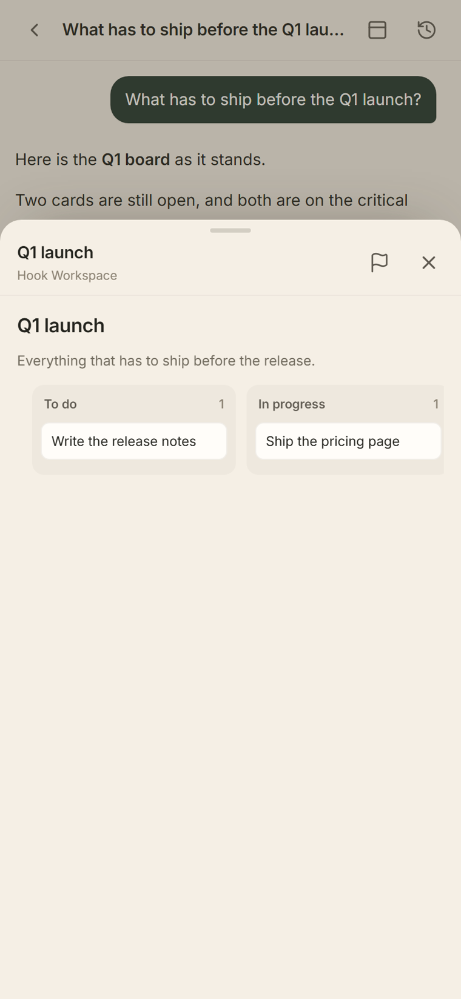

# Hook on a phone

HookCode: the same backend, the same chat surface and the same account, with nothing that needs a folder on a disk.

 

HookCode on a phone (`apps/mobile`, identifier `app.hook.mobile`) is the third
product and the first one that is not a desktop installer. It is the same
conversation and the same account, with the chat agent's hands in Hook
Workspace — and nothing that needs a folder on a disk.

It is the same code, not a second implementation:

- **The backend is `hook-core` with `Capabilities::mobile()`.** Workspace tools,
  memory, `web_search` and `search_past_chats` are on. `coding_agents`,
  `projects` and `preview_pages` are off, and the prompt sections that describe
  them — `## Projects` and `## Preview panel` — are removed before the model sees
  them, so the agent is never told to open a folder it cannot reach. The
  `## Coding agents` section stays, with one added line: this device is a
  controller, so it starts and steers work on a computer but never runs an agent
  itself.
- **The turn runs on the device.** The same `turn.rs` loop, the same tools, the
  same `/api/v1` endpoint. Nothing server-side was added to make this work, and
  there is no second system prompt to keep in step. The trade is that iOS
  suspends the app: a reply that is still streaming when the screen locks is
  persisted as it stands and finishes as an error you can retry, rather than
  completing in the background.
- **The chat surface is `packages/chat`.** `mobile.css` is the phone's re-skin of
  the same thread and composer, the way `dock.css` is the 380px re-skin. The
  composer uses the WebView's own `<input type="file">`, which opens the camera
  or the photo library without a plugin.
- **The home screen is a new conversation.** Like the desktop window, the phone
  opens on a greeting and the composer; sending starts the chat and the same
  screen becomes its thread. The archive is one tap away behind the history
  button, on the home screen and in the conversation header, with the same
  pin, rename and delete actions a long-press would show if a phone had
  somewhere to put a menu.
- **Coding agents are an Advanced action, here as on the desktop.** The **Code on
  <machine>** chip on the home screen, the archive's coding-agent rows and the
  conversation that would show one all follow the account's advanced mode. With
  it off the chat agent is the way in: it has the agent tools and the machine
  list, so it decides whether a machine is needed and starts the run itself. A
  phone does not offer a second, simpler path into the same agent.
- **The Android back gesture is navigation, not close.** `src/lib/back.ts`
  keeps a small layer stack: a report dialog closes first, then a sheet, then
  the thread or the list. Only the home screen lets the gesture leave the app,
  and `capabilities/default.json` grants `core:app:allow-exit` because
  registering a `back-button` listener turns off the app plugin's own close.
- **The keyboard takes the bottom of the screen, not the title.** Since
  targetSdk 35 Android runs an edge-to-edge app without resizing it for the
  keyboard, so the system pans the whole page instead. `plugins/mobile-shell`
  pads the window by the IME inset; the header stays put and only the thread
  gives way. `Thread` also watches its own height, so a reader at the bottom
  stays pinned when the keyboard opens.
- **Signing in fills the list in place.** `init` ran before there was a token,
  so its list is empty; `hook://auth` reloads chats and wakes the sync engine
  (which the mobile store used to ignore), and `hook://sync` reloads again when
  the background pull applies the desktop's conversations. No restart needed,
  and a chat streaming on this device is never replaced by the account's copy.
- **The preview is a sheet.** `workspace_preview` already returns the board,
  task or document as JSON, and `packages/chat/src/preview` draws it. The
  desktop puts that in a 440px column; a phone has nowhere to put a column, so
  the same components come up from the bottom. `preview_pages` is off locally
  because the HTML page a coding agent writes is served from a project folder
  this device does not have — which is exactly why `Capabilities` separates the
  two. A page from a computer arrives over the relay as a ticket URL and is drawn
  in the same sheet.
- **Signing in is the device flow, unless the device has a sheet of its own.**
  The desktop asks for a code, opens the browser, and polls. A phone calls
  `GET /api/auth/config` for the web client id, opens Android's Credential
  Manager sheet (`plugins/google-signin`), and posts the ID token to
  `POST /api/auth/google`, which mints the same app token under the same approval
  rule. There is no deep link and no second account flow. The token belongs in
  the OS keystore, not in a file the way `account.json` works on Windows.
- **No installer.** Xcode and Gradle build it; the App Store and the Play
  Console distribute it. `scripts/release.sh` does not touch it, and
  `scripts/products.mjs` marks it `kind: "mobile"` so nothing assumes an NSIS
  bundle exists.

A phone cannot run a coding agent: iOS forbids executing a bundled interpreter
and has no background execution to speak of, and Android only allows it through
machinery (a userland in the app's storage, or a bundled node in the native
library directory) that turns the app into a different product. Coding agents
stay on a computer that is on; the phone is where you start them, read the
progress, approve a question and steer them.

---

[Documentation](README.md) · [Hook](../README.md)
