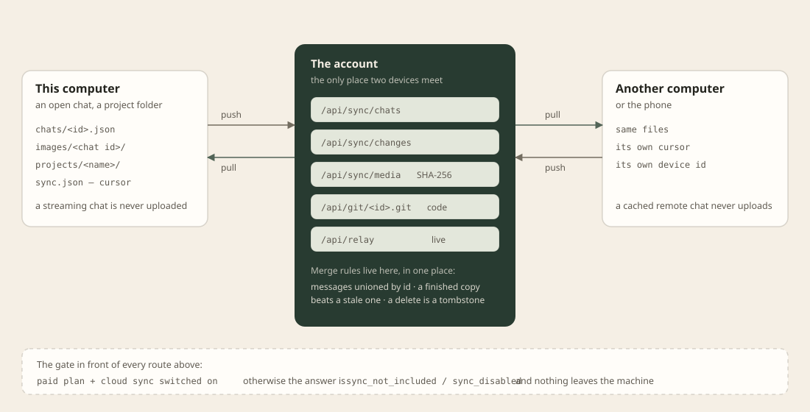

# Sync between computers

What travels, what merges, what never leaves the machine, and the gate in front of all of it.

A paid account keeps the whole workspace in step without a button, unless the
account has switched cloud sync off (see
[Plans, limits and your own model](plans.md)). A free account never syncs.
Several independent mechanisms are at work:

- **Conversations.** Each device pushes changed chats to `/api/sync/chats` and
  pulls everything newer than its cursor from `/api/sync/changes`. The server is
  the only merger, so every machine converges on the same answer: messages are
  unioned by id in transcript order (a tool result stays next to the call that
  asked for it — creation time is not message order, because the memory frame
  is written at the top of a chat although it is created after the question),
  a finished copy beats a stale in-flight one, titles and pins
  follow the newer chat, a deletion is a tombstone, and an explicit restore
  revives it. A chat that is streaming is never uploaded, and never overwritten:
  the check is on the copy **on this machine**, because the incoming copy cannot
  show a turn that has not been uploaded yet. Before that fix, the account's
  older copy could land on top of a reply mid-stream, the reply would be lost,
  and the window waited forever for a message that no longer existed. Pictures travel by SHA-256 through `/api/sync/media`, so the same
  screenshot is stored once. The desktop polls every 15 seconds and immediately
  after sign-in, window focus, a finished turn or a coding-agent note. Settings
  has the account switch, a small status line and a manual nudge for support.
- **Code.** Every project is a real git repository whose remote is Hook's
  service (`/api/git/<project id>.git`). Coding agents pull before they start
  and push when they finish, so a project started on one computer arrives on
  the next one. The same policy gates it: a free account, or a paid one with
  sync off, keeps its projects local — no remote, no git token, and no
  `sync_pull` / `sync_push` tools in the agent. The account stores one bare repository per project; a pre-receive
  hook rejects pushes that would take a project over 200 MB or an account over
  1 GB, and a single push is capped at 100 MB.

- **Memory.** One row per entry over `/api/sync/memory`, folded into the same
  `/api/sync/changes` cursor as chats and projects. Last write wins on the
  device's clock, and a forgotten memory is a tombstone, so a deletion on one
  computer does not come back from another. It is not one document per account
  on purpose: two devices editing different memories merge instead of
  overwriting each other.
- **The live relay.** `/api/relay` is a WebSocket, not a store: presence, remote
  commands and the live copy of a turn on another machine. It is gated by the
  same paid + sync-on rule, so a free account or a switched-off account cannot
  reach another device through it. A missed frame costs nothing; the viewer
  reloads the chat through the normal sync path.

Project identities belong to the account, not to an installation. Because both
Hook and Hook Workspace open the same projects folder on a machine, two windows
can see the same folder under two different local ids; the account's id wins. A
folder bound to an account project keeps its id and its place, and a duplicate
name coming back from the server makes the local copy adopt the account's id
rather than create a second folder. A folder the account cannot accept — a name
over 64 characters, or one Windows reserves — stays on that machine and is
skipped by itself, so one impossible name cannot stop the rest of the account
from syncing.

A project is deleted by deleting its folder or with **Remove** in Settings. The
note goes with it and the account gets a tombstone, so the next pull cannot
create the folder again — the two together are what make a deletion stick. The
folder itself is removed only when it holds nothing but Hook's `.git`, an empty
clone made for a project that arrived from another computer; a folder with work
in it is the user's, and Hook refuses rather than guess. A deletion on one
computer never deletes another computer's copy: that folder is still there, and
its next push puts the project back on the account.

On Windows, Hook runs the Git commands for startup and background project sync
without opening terminal windows.

Quotas: 250 MB of conversation JSON, 250 MB of chat pictures, 5,000 chats,
200 projects and 1,000 memories per account. Limits are server constants in `server/sync.mjs` and
`server/git.mjs`. A project folder that disappears takes its project off the
account with it (a tombstone, not a missing row); sign-out leaves the account's
data in place. `DELETE /api/sync/account` (app token)
removes the account's chats, pictures, memories and repositories, and it keeps
working for an account that has gone free or turned sync off.

The policy itself is `syncRefusal()` in `server/plans.mjs`, applied by a gate on
every sync route except the account deletion, and mirrored client-side by
`policy_for()` in `sync.rs` — which also polls `/api/auth/me` every minute so a
plan change or a switch flipped in another product arrives without a restart.

Signing a different account in on the same machine moves the previous account's
conversations to `accounts\<id>\` instead of uploading them anywhere. Project
folders are the user's own files and stay where they are.

An AI report (see [Reporting AI output](reporting.md)) is the one deliberate
exception to "sync everything": it contains what the user chose to send, never
the whole account.

---

[Documentation](README.md) · [Hook](../README.md)
