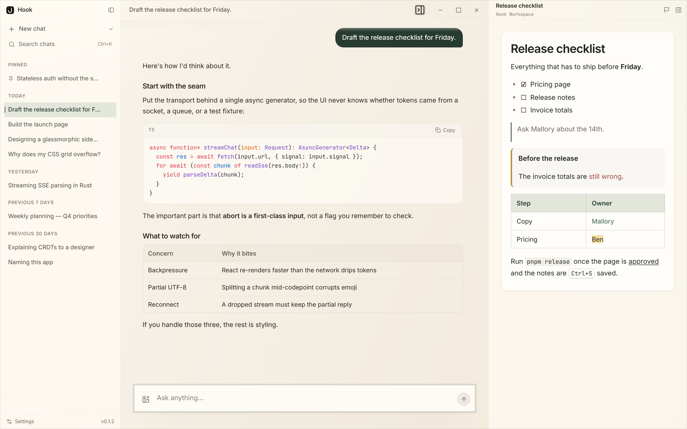
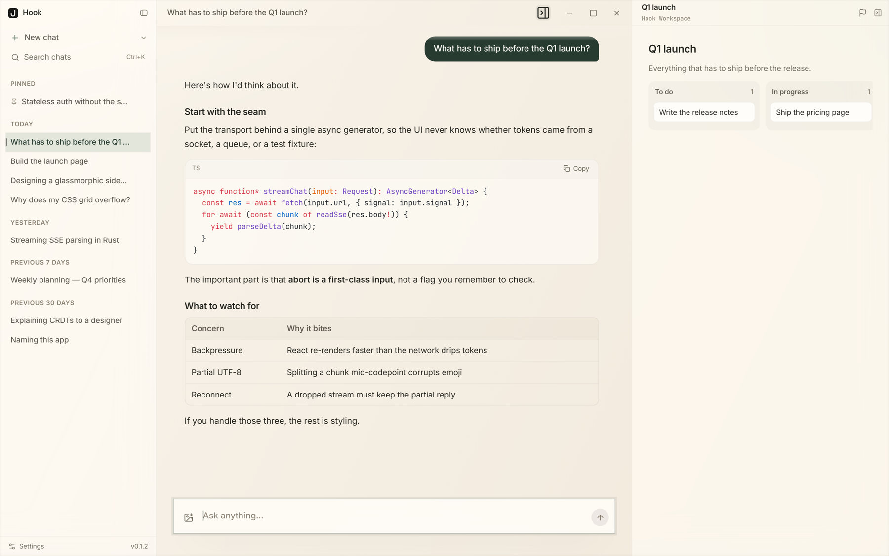

# Hook Workspace

Projects, boards, tasks, documents, roadmaps, permissions — and the service behind all of it.

The second product. A project holds boards of tasks, Markdown documents,
roadmaps of milestones and the people they are shared with; folders organize
them, and can nest. It is its own installer
(`apps/workspace`, identifier `app.hook.workspace`) with the same window chrome,
the same account and the same chat beside it.

Home surfaces pending invitations before the getting-started actions, with the
project name, inviter profile when available, and Accept/Decline buttons. Accept
opens the joined project. Home also lists existing projects and offers Create a
project and Plan with Hook. Home and Invites sit near the top of the rail;
the invite count stays visible while working inside a project.

One rail, one tree: projects read as special folders (they are the unit of
sharing), and everything inside one — nested folders, boards, documents — is a
row under it. Nothing lives in a second column. Right-click anything in the
tree to rename, delete, create inside it, or move it to another folder; the
same menu opens from the plus on a project or folder. A board opens as a table
with one task per row, the board's own columns across, and a grip to reorder
the rows (the kanban is the second tab, not the only view).
The project overview highlights boards and documents, with a plus beside each
heading for editors and managers. The People button opens members and invitations.
Below Boards and Documents, Quick access shows favorites first, then recently
opened and edited work without duplicates. Favorites and recently opened items
are saved on this device for the signed-in email and project; recently edited
uses the items' server-provided edit times. Quick access tiles load board tasks
or formatted document content for a preview when the tile comes into view.
Creating a board opens a **template picker** grouped for personal use, study,
product/engineering and business, plus a blank board. Templates are data, not
features: each one is just a name suggestion, a set of properties, a default
view and example rows. A to-do list, assignment tracker, roadmap, sprint, CRM
and content calendar are all the same board underneath.
`apps/workspace/src/lib/boardTemplates.ts` owns the presets.

A board's columns are **properties**. From **Properties** in the board header an
editor can add, rename, reorder, hide or remove them, and add/rename/reorder/
recolour/remove choice and status options. Supported types are title, text, long
text, number, checkbox, select, multi-select, status, person, date, date & time,
timeline, progress, URL, email and phone. Values live in the task's `fields`
object (status and assignees stay first-class columns), so adding a property
never requires a new database table. Simple boards only show the properties
their template chose; the table no longer invents an assignee column.

Opening or creating a board task shows its details, description and comments in
a full task view with a properties sidebar for status, multiple assignees and
dates. The description uses the document formatting toolbar and automatically
saves edits. Back to board returns to the selected board view. **Filter**
narrows both the table and board views by status or any select column (such as
Priority), and can combine several columns. The board view can group by any
status or select property. The last row of the table is an inline quick add:
click **New task**, type a title and press Enter to append it without opening
the task view.

The important structural decision: **the workspace service is the product; the
window is a client.** `server/workspace.mjs` owns projects, memberships,
invitations, folders, boards, tasks, comments and documents, and enforces roles
on every request. That is what lets Hook's chat agent do the same work on a
machine where Workspace is not installed, and it is why there is no local merge
to write: a device applies `/api/ws/changes` and converges.

Roles: `viewer` reads, `editor` creates and edits, `manager` also invites
viewers and editors, `owner` deletes the project and transfers ownership. A
manager cannot mint another manager, and ownership only moves to someone who
accepted the invitation and is already a manager — the Workspace dialog says
that it is permanent and cannot be undone.

- **Work is assigned by account, or by address before the account joins.** A
task holds an `assignees` list, so several people can own it; `assignee` mirrors
the first entry for older clients and tools. Each value is a member's account
subject. Someone invited has no subject on the project until they accept, so a
task assigned to them carries the address the invitation went to, and that is
all anyone sees of them. The members endpoint returns those addresses under
`pending` (for the people who can invite, like the invitations list); accepting
the invitation rewrites every matching entry to the account, each with a new
`seq`, so it becomes their name on every board and every device. An address that
already belongs to a member is stored as the subject in the first place, and
rows written before this rule are adopted when the service starts.

- **One cursor.** Every workspace row carries `seq` from one global counter;
  `GET /api/ws/changes?since=N` returns rows in projects the caller belongs to,
  tombstones included, bounded by rows and bytes. Clients keep the last `seq`.
- **Documents are Markdown.** The buffer is the document, so there is no
  round-trip to lose formatting. A formatting toolbar adds headings, lists,
  checklists, links, inline styles, code blocks, dividers and Markdown tables.
  The formatted editor is the default and lets people edit table cells directly.
- **Formatting beyond Markdown is a directive, not HTML.** Inline styles are
  written in the text itself — `:red[…]`, `:green[…]`, `:blue[…]`, `:purple[…]`,
  `:mark[…]`, `:underline[…]`, `:kbd[…]` — and a callout is a block:
  `:::note[Title]` … `:::` (also `tip`, `warning`, `danger`). A label holds
  ordinary Markdown, so `:red[a **bold** word]` works, and blocks nest by adding
  a colon (`::::note[…]` around `:::tip[…]`). A word that is not a registered
  rule, an empty label and a block word used in a sentence all stay exactly as
  typed, so prose like `localhost:8080` is never reformatted. Raw HTML is not
  rendered at all — it is shown as the text it is — which is why every surface
  (the Workspace window, the chat side panel and the phone) draws the same
  document the same way, without a sanitizer.
  **`document-markdown.md` is the syntax**, written for a person and for
  the chat agent at once: the rules, where each works, what stays literal, the
  traps and the document options. The agent reads it on demand through the
  `document_markdown` tool instead of carrying it in every prompt, and
  `pnpm test:markdown` fails if a registered rule is missing from it.
  `packages/markdown/src/rules.ts` is the whole registry: one entry names a
  word, an element and a class, and the live editor, the toolbar and every
  preview pick it up together. Reading draws the page with `.hook-doc`
  (`packages/ui/src/tokens.css`), whose numbers are the formatted editor's, so
  the chat side panel, the phone sheet and the dashboard tile show a document
  the way the Workspace window does — direction and line breaks included.
  Editing behaves the way a word processor does:
  inline markup is invisible, so an edit only ever changes the text it wraps and
  the markers are put back around whatever survived. The caret stops at the
  content edge of a run — never on a marker — so an arrow key always crosses a
  visible character, a click at the end of a run lands inside it (typing
  continues the run), and Backspace removes a character rather than the colour.
  Delete the whole content and the construct goes with it. A callout or a picture is a unit instead: deleting at
  its edge removes it. Inline HTML from older documents
  (``, `<mark>`, `<u>`) is rewritten to the
  directive syntax when the service starts; a code sample keeps its HTML.
  One upstream trap to know: a fenced code block inside a callout must not
  contain a line of nothing but colons, because that closes the callout early.
  Give the callout one more colon than the sample needs.
  Use **Add image** in a document or task description to insert a web image or
  select a PNG, JPEG, GIF, or WebP file. You can also paste an image from the
  clipboard or drop an image file onto the editor. Embedded images sync with
  the Markdown and count toward its 512 KB limit. Large files are
  resized to fit, and animated GIFs may become still images when resized.
  In the formatted editor, Backspace and Delete remove an adjacent image as a unit.
  Hover over a web link for its address and open action, or Ctrl-click it to open.
  Document options also offers Markdown source editing, left-to-right or
  right-to-left text direction (also a toolbar toggle), and deletion. The
  direction is stored with the document, applied to the editor and every
  preview, and the chat agent can set it through `workspace_documents`.
  A write carries the revision it was based
  on; a stale one is refused with the current copy rather than silently overwriting
  someone else's paragraph.
- **A roadmap is a project item; milestones live inside it.** A roadmap sits in
  the tree and the project overview like a board or document. It opens as a
  horizontal timeline where each milestone is a large circle carrying its date,
  status, title and description preview, connected by a line. It scrolls left
  to right with momentum and elastic edges, supports drag from anywhere and
  Ctrl + wheel zoom, and keeps the clicked circle in view instead of jumping
  back to the start. Clicking a circle opens a Motion-animated drawer for
  editing that milestone. Hovering a gap or using the always-visible right-edge
  button adds another milestone there, dated one day after the milestone before
  it. Milestones themselves are not tree items.
- **Comments know how they were written.** `author_kind` is `user` or `agent`,
  and an agent comment carries the conversation it came from, so a teammate sees
  "via Hook agent" instead of mistaking it for something the user typed. The
  author can edit or delete their own comment; a manager or owner can edit or
  delete any comment on the task.
- **The chat agent can do everything a person can, except transfer ownership.**
  `workspace_projects`, `workspace_folders`, `workspace_boards`,
  `workspace_tasks`, `workspace_comments`, `workspace_documents`,
  `workspace_roadmaps`, `workspace_milestones`, `workspace_members`,
  `workspace_invites` and `workspace_preview` are ordinary
  chat tools (`crates/hook-core/src/workspace.rs`) that call the account API with
  the user's token, so the server checks the user's real role. `document_markdown`
  is the one that answers from the binary: the dialect's reference, so a style it
  writes is a style documents can render.
- **Previews.** `workspace_preview` puts a task, board or document in the preview
  panel. It is a second kind of preview next to the HTML page a coding agent can
  show, and the panel renders it directly instead of in an iframe.
- **Folders are rows, not a client feature.** A folder carries a name, an
  optional parent and a position; a board, a document or a roadmap carries a
  `folderId`. Deleting a folder deletes what it holds — nested folders, boards with their
  tasks and comments, documents, roadmaps and their milestones — each row a tombstone of its own, and the
  dialog counts what goes before it happens. Two people see the same tree
  because it is the project's, not theirs.
- **The window is online-first.** The server is the source of truth, so the app
  keeps an in-memory copy and applies `/api/ws/changes` every five seconds while
  visible (and on focus). Nothing on disk can drift from the account, and there
  is no merge to get wrong. Offline work is the next step, not a promise made
  here.
- **The chat sits beside the work.** A collapsible right-hand panel embeds the
  same conversations as Hook (`packages/chat`). It is the chat window at 380px,
  not a reduced panel: the same greeting and suggestions on an empty
  conversation, the same thread and composer, and one button that covers the
  column with the conversation list — search and new chat included — because a
  panel inside a panel cannot show both. The thread, the messages and the
  composer are the ones the chat window renders, so there is one chat surface
  to fix, not two. It has no preview panel; a preview is a
  wide, page-shaped thing, and the dock is deliberately narrow. The window tells
  the backend what it is showing — project, board, open task, selected text — and
  that rides on the next request as context, so "summarise this board" means the
  board on screen. The context is never stored in the chat.
- **Its own download slot.** `/api/releases/workspace` and
  `/api/download/windows?product=workspace` serve the Workspace installer; the
  chat app keeps its historical URLs. Installers are uploaded under versioned
  names and the index is swapped last, exactly like the chat app.

---

[Documentation](README.md) · [Hook](../README.md)
